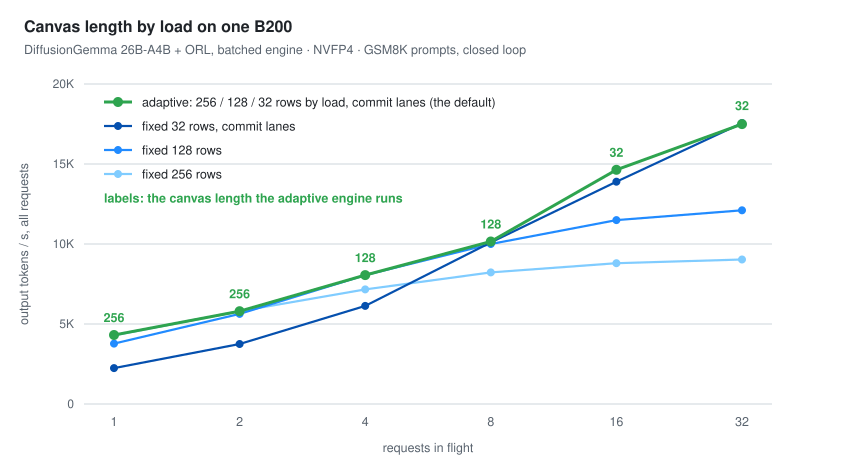
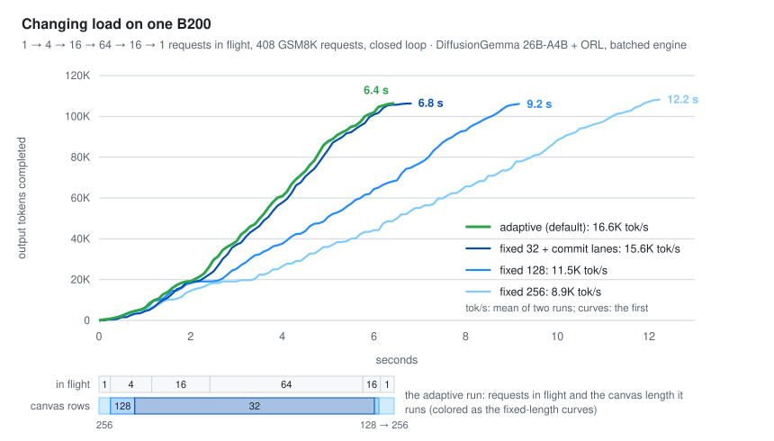
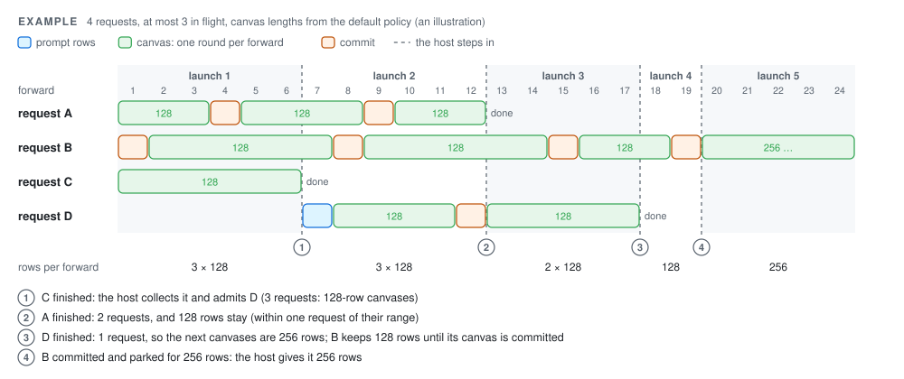

# Batched DiffusionGemma

`BatchedGemmaEngine` ([dlmrt/models/diffusion_gemma/batched.py](../dlmrt/models/diffusion_gemma/batched.py)) serves
many DiffusionGemma requests per forward on one GPU. Each request runs at its own stage (a prompt chunk, a canvas
round or a commit) with its own canvas length, and the stages advance on the GPU after every forward: the host steps
in only when a request finishes or changes canvas length. A request that runs alone goes through GemmaEngine's
forwards in GemmaEngine's order and emits GemmaEngine's tokens.

The engine picks each request's canvas length from the load: long canvases while few requests run (each forward
streams the expert weights for many tokens), short ones under load (rows per forward stay near the point where they
start to cost time). On one B200 it is ahead of vLLM's DFlash speculative decoding at every concurrency we measured
(see [Measurements](#measured-on-one-b200)).

## Running it

```bash
# closed loop at each concurrency (the paper's GSM8K problem file); writes per-level records and a summary
python -m dlmrt bench throughput --model DG_ORL_NVFP4 --role orl --problems gsm8k.jsonl --out results/throughput
python -m dlmrt bench throughput --model DG_ORL_NVFP4 --role orl --problems gsm8k.jsonl --phases 1:4,4:16,16:64,64:256,16:64,1:4
# one request at a time: the batched engine's tokens against GemmaEngine's (exit code 1 on a difference)
python -m dlmrt bench identity --model DG_ORL_NVFP4 --role orl --problems gsm8k.jsonl --count 3
python -m dlmrt bench identity --model DG_ORL_NVFP4 --role orl --canvas-length 32 --stop-rule freeze_argmax
```

`throughput` runs the configuration below by default; `--tiers 0:32` fixes one canvas length, `--no-fused` turns
commit lanes off and `--prefill R` takes prompts in chunks of R rows. Each level runs max(`--count`, 4 × N) requests
(default 128) after a warm-up request; `--skip S` starts at problem S. Records go to `<out>/c<N>/requests.jsonl` in
the layout `benchmarks/compare_runs.py` reads, so two runs compare token for token.

From Python:

```python
from dlmrt.models.diffusion_gemma import ROLES
from dlmrt.models.diffusion_gemma.batched import BatchedGemmaEngine, LoadPolicy

engine = BatchedGemmaEngine.load("DG_ORL_NVFP4", ROLES["orl"], max_batch=128, max_seq_len=4608,
                                 blocks=(256, 128, 32), stops={32: "freeze_argmax"}, policy=LoadPolicy(), fused=True)
results = engine.run(prompt_token_ids, max_new_tokens=4096)  # lists of token ids, at most max_batch in flight
for r in results:  # BatchedResults, in prompt order
    print(len(r.token_ids), r.blocks, r.request_tps)
```

`run(..., concurrency=N)` keeps at most N requests in flight (default max_batch); `concurrency=[(N1, k1), ...]` applies
N1 to the first k1 requests and so on, and `on_finish(result)` is called as each request finishes. The KV cache holds
max_batch + 1 contiguous arenas of `max_seq_len` positions (about 225 KB per position for the NVFP4 export: 134 GB at
max_batch 128 and 4608 positions), so `max_seq_len` must cover the longest prompt plus its token budget, not more.

### The default configuration

The constructor's defaults are those of a single canvas length (the checkpoint's, 256) without commit lanes. The
configuration `dlmrt bench throughput` runs, and the one measured below, is:

- **canvas lengths 256 / 128 / 32 by load**: `LoadPolicy()` gives 256 up to 2 requests, 128 up to 11, then 32, and
  keeps the current length while the load is within one request of its range;
- **stop rules**: `freeze_argmax` for 32-row canvases, the reference rule (`renoise`) for 128 and 256. Below 64 rows
  the reference rule rarely stops a canvas before its 48-round cap; `freeze_argmax` stops after at most 32 rounds
  (see `GemmaDecode.stop_rule`);
- **commit lanes** (`fused=True`): from 8 requests on, a stopped canvas of up to 64 rows is committed in the same
  forward as the next canvas's first round, in rows after the requests' own (+4–9% at 16–128 requests);
- prompt chunks off: `prefill=R` cuts the time to the first canvas by 21–30% under load, at −1 to +3% throughput with
  128-row chunks beside 32-row canvases and −2 to −7% with 256-row chunks in the adaptive engine.

## How it works

<picture>
  <source media="(prefers-color-scheme: dark)" srcset="../assets/batched-launch-dark.svg">
  
</picture>

One launch serves every request in the batch until one of them finishes or parks:

```
one launch = admit -> WHILE(some request runs and none has finished or parked since the launch){
                 embed + forward -> [LM head + decoder] -> advance [-> claim] -> [self-conditioning]}
```

Inside a launch the GPU moves every request on after each forward. The host steps in between launches only, to
collect finished requests, admit new ones and change canvas lengths: 0.4–1.0 ms per launch in the runs below.

### Stages per request

<picture>
  <source media="(prefers-color-scheme: dark)" srcset="../assets/batched-stages-dark.svg">
  
</picture>

Each request's stage lives at its KV slot: PREFILL (its next prompt rows, causal), DENOISE (a round of its canvas,
bidirectional over the canvas), COMMIT (the stopped canvas's causal re-encode), SWITCH (parked between two canvases
until it has rows of another length), DONE / IDLE. After each forward, `advance` moves every request on by itself: a
stopped canvas is recorded and committed in the next forward unless it ends the request (an EOS within the budget, or
the last canvas, which GemmaEngine does not commit either); a commit or the prompt's last chunk begins the next
canvas. No canvas waits for another, and prompts are prefilled inside the shared forwards.

### Rows and the launch graph

- **Ragged rows.** Request p owns a contiguous range of B_p rows, B_p one of up to four canvas lengths. Row kernels
  (embed, Q/K-norm + RoPE, logit statistics, the SC softmax) read a per-row (slot, index) map; an attention query
  tile reads it at its first row, every request's rows being aligned to the launch's alignment. The per-request
  kernels (admit, advance, adaptive temperature, decide) branch to a body compiled for each canvas length inside one
  launch, so each request runs the single-request kernel's code. The LM head, decoder and SC skip the rows of
  requests that are not denoising.
- **The launch graph.** `StagedLoopGraph` (`dlmrt/ops/csrc/block_graph.cu`) is the block graph's WHILE loop with
  IF nodes around the parts that only run when some request is denoising: the decoder when this forward has a canvas
  round, the self-conditioning when the next forward has one past its round 0. One graph per row bucket, all built
  at start; the buckets follow FlashInfer's MoE token buckets, so every forward's row count runs its own tuned expert
  tactic.

### Canvas length by load

<picture>
  <source media="(prefers-color-scheme: dark)" srcset="../assets/canvas-b200-dark.svg">
  
</picture>

Which canvas length serves best depends on the load. With one request, a 256-row canvas settles about 29 tokens per
round at 5.6 ms per forward and a 32-row canvas about 10 at 3.2 ms: the forward is bound by reading the weights, the
extra rows cost little, and 256 rows run 1.9× faster (4296 against 2242 tok/s). Under load every request's rows add
to the forward and the tokens a row settles decide: 0.33 per round for 32-row canvases, 0.16 for 128 and 0.11 for 256
rows, so from 16 requests on 32-row canvases are fastest (13.9K tok/s at 16 requests, against 11.5K at 128 rows and
8.8K at 256).

The engine holds graphs for 256-, 128- and 32-row canvases over one set of weights and picks the length from the load.
`LoadPolicy()` follows the crossovers of the fixed lengths above: 256 rows up to 2 requests, 128 up to 11, then 32,
keeping the current length while the load is within one request of its range, so a load that moves by one request
does not switch back and forth. A request takes the new length at its next canvas ([Scheduling](#scheduling)).

In steady state the adaptive engine runs the best fixed length's canvases at its throughput (0.996–1.006× at 1–8 and
32 requests), and passes it where the last requests of a level, as it drains, run longer canvases (1.05× at 16
requests, 1.07× / 1.05× at 64 / 128). Its gain is under a changing load:

<picture>
  <source media="(prefers-color-scheme: dark)" srcset="../assets/phased-b200-dark.svg">
  
</picture>

It runs 256-row canvases while one request runs, 128 at 4 and 32 from 16 on, and back, and serves the 408 requests at
16.6K tok/s: 1.06× the throughput of fixed 32 with commit lanes, slow in the low-load phases, and 1.44× / 1.87× that
of fixed 128 / 256, slow under load.

### Scheduling

<picture>
  <source media="(prefers-color-scheme: dark)" srcset="../assets/batched-schedule-dark.svg">
  
</picture>

When a launch ends, the host:

1. reads back every request's stage and the finished requests' canvases (one copy each);
2. asks the policy for the canvas length of a batch of n requests (the concurrency limit, or the requests left when
   fewer) and sets it as every request's wanted length. `LoadPolicy()` gives 256 up to 2 requests, 128 up to 11, then
   32, and keeps the current length while n is within one request of its range;
3. gives each parked request rows of the length it wants, within the row budget `max_rows`;
4. admits waiting requests into the freed batch positions, then after the last one, while the concurrency limit and
   `max_rows` allow; a new request gets rows of the wanted length (or a prompt chunk, with `prefill`);
5. moves the last requests into the gaps, lays out the rows, and moves the rows a request carries between forwards
   (tokens, canvas, accepted mask, SC delta) when its first row changed;
6. with commit lanes, picks how many lanes the launch holds (below), and relaunches the loop built for the row count.

A request keeps its rows until its current canvas is committed: a new wanted length takes effect at its next canvas,
when the request parks (which ends the launch) and the host gives it rows of that length. Committed context is
ordinary causal KV at the request's slot, so nothing moves but its rows. In the example, B finishes the 128-row canvas
it is in after ③, commits it and parks; from ④ it runs 256-row canvases.

### Commit lanes

From 8 requests on, at canvas lengths up to 64, a launch holds lanes of its canvas length after the requests' rows, as
many as the claims it expects per forward make cheapest: the claim rates are measured over the run and the claims per
forward taken as Poisson; a lane costs its rows, a canvas that finds none its request's share of a forward. A stopped
canvas takes a lane in request-position order: its tokens are copied to the lane, mapped to its slot just before the
next canvas, and its next canvas begins at once; the commit runs in the same forward as that canvas's first round,
whose attention reads the lane's K/V written earlier in each layer. One that finds no lane commits in its own rows.

## Measured on one B200

DiffusionGemma 26B-A4B + ORL, NVFP4 export, ORL decoder, TP=1; the paper's GSM8K prompts, closed loop (N requests in
flight until every request of the level has finished), at most 4096 new tokens; 128 requests per level up to N = 32
and 4 × N above (the first problems of the file). Aggregate tok/s, mean of three runs (fixed 256 / 128: two).
"adaptive" is the 256 / 128 / 32 engine, "fused" adds commit lanes; "fixed B" runs one canvas length (32:
`freeze_argmax`).

| N | 1 | 2 | 4 | 8 | 16 | 32 | 64 | 128 |
| --- | ---: | ---: | ---: | ---: | ---: | ---: | ---: | ---: |
| fixed 256 | 4296 | 5797 | 7162 | 8223 | 8803 | 9031 | 9209 | – |
| fixed 128 | 3772 | 5634 | 8057 | 10001 | 11496 | 12107 | 12339 | 13019 |
| fixed 32 | 2219 | 3749 | 6141 | 9096 | 13314 | 16229 | 18461 | 21328 |
| fixed 32, fused | 2242 | 3751 | 6131 | 10098 | 13892 | 17557 | 19722 | 22530 |
| adaptive | 4310 | 5814 | 8082 | 10116 | 13768 | 16756 | 19969 | 21696 |
| **adaptive, fused (default)** | **4311** | **5800** | **8055** | **10157** | **14638** | **17491** | **21168** | **23720** |
| vLLM 0.31 DFlash, best draft length | 1148 | 2050 | 3587 | 6478 | 9315 | 13944 | 18835 | 20069 |
| vLLM 0.31 autoregressive | 332 | 671 | 1237 | 2143 | 3678 | 5891 | 10139 | 13939 |
| GSM8K accuracy (%), adaptive fused | 90.6 | 88.3 | 91.4 | 90.6 | 91.4 | 91.4 | 89.8 | 91.2 |

- **Against vLLM.** Adaptive fused is 3.8 / 2.8 / 2.2 / 1.6 / 1.6 / 1.25× DFlash at N = 1–32. At 64 and 128, over two
  prompt windows (problems 0+ and 512+), it averages 21430 and 23935 tok/s: 1.14× and 1.19× DFlash, 2.1× and 1.7×
  autoregressive decoding.
- **Against the fixed lengths.** The adaptive engine runs the best fixed length's canvases in steady state (256 at
  N ≤ 2, 128 at 4–8, 32 from 16) and gains at the end of each level, when the last requests move to longer canvases.
  Under phased load (1 → 4 → 16 → 64 → 16 → 1 requests in flight, 408 requests, max_batch 64) its throughput is 1.06×
  that of fixed 32 with lanes and 1.44× / 1.87× that of fixed 128 / 256 (16.6K tok/s goodput; charts in
  [Canvas length by load](#canvas-length-by-load)).
- **Batch 1.** With one request the engine emits GemmaEngine's tokens and denoise steps at 1.00–1.02× its speed
  (1024 tokens, EOS ignored, best of three: 85.8 vs 86.8 ms at 256-row canvases, 461.9 vs 471.6 ms at 32; within ±1%
  with other jobs on the node).
- **Accuracy** is the same with commit lanes on and off and in every configuration (88–91% per level), and no run
  re-noised a NaN position.

**Caveats.**

- **One workload.** GSM8K prompts are short (under 260 tokens) and its answers run up to about 1300 tokens; long
  prompts and long contexts, where attention and per-request KV reads weigh more, are not measured. Neither are other
  GPUs (the RTX 5090 included) or concurrencies above 128.
- **The baselines run another model on another B200.** vLLM 0.31.0 serves Gemma 4 26B-A4B NVFP4 (the same prompts),
  autoregressively and with a DFlash drafter at its best draft length per N (CUDA graphs captured up to 4096 tokens
  per step; vLLM's default 1024-token capture limit halves DFlash at 64–128 requests). Their closed-loop levels last
  2–10 s and vary by up to ±20% between runs at 16–32 requests; dlmrt's repeats of a level agree within about ±1%.
- **Numerics.** With commit lanes, and with prompt chunks, forwards hold other row counts than GemmaEngine's, so
  tokens differ from GemmaEngine's from the first such forward on (the `identity` command runs one request, where
  neither applies). Under load every request's tokens depend on what it shares forwards with; a run is
  deterministic for a given problem order and concurrency.
- **Memory checking.** compute-sanitizer (and CUPTI) do not see kernels inside CUDA conditional graph bodies, which
  hold every kernel of the launch loop: a memcheck of the graphs reports 0 errors even on a faulting run. The engine
  was checked by running the loop's stages eagerly under memcheck (0 errors), which compute-sanitizer can only
  sustain for a few hundred forwards at small batch: it keeps every forward's temporaries allocated.
  `nsys --cuda-graph-trace=node` does see the bodies.

## Limits and follow-ups

- **One GPU** (no tensor parallelism), and the Triton attention kernel only (on Hopper set `DLMRT_DG_ATTENTION=triton`).
- **Not in `dlmrt serve` or `LLM` yet.** A launch returns to the host only when a request finishes or parks, so
  streaming canvases as they finish and admitting a request that arrives during a launch need a loop the host can
  interrupt; the server runs one request at a time through GemmaEngine.
- **KV**: contiguous per-request arenas sized for the longest request; no paging or prefix cache.
- **Modes**: diffusion only. Self-speculation (the commit pass verifying a drafted canvas) and an autoregressive
  low-row path are the next tiers for higher load.
